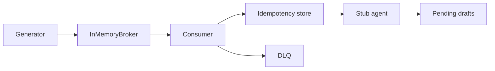

# cdc-to-agent-events-lab

Synthetic change stream for the fictional shipper Ruta Sur Logística (`@rutasur.example`): at-least-once delivery, an idempotent effect, and a stub agent that only drafts notices.

CI exercises an in-memory broker with a simulated clock. The Docker/Kafka path is optional and is NOT exercised in CI unless this README says a CI job runs it. No real database or broker was used for the measured results.

Measured with real providers: none yet.

## Problem and result

A delayed premium shipment should become one draft, even if the change event is delivered twice, arrives out of order, or the process crashes before the offset commit. Poison records must sit on a DLQ instead of blocking other keys.

On 2026-10-17, package 0.1.0, Python 3.12.3, `python3 -m cdc_lab eval` reported **0 violations across 10 scenarios** (measurement commit `PENDING_SHA`). Forced regression (`python3 -m cdc_lab eval --regression`) exits 1 because `evt-000001` is applied 5 times when idempotency is off.

## Demo

```bash
python3 -m pip install -e ".[dev]"
python3 -m cdc_lab demo
python3 -m cdc_lab eval
```

`demo` prints the accounting identity and `clock: simulated`. Drafts stay `pending`. Logs are JSON on stderr.

## Business case

Four premium delay drafts in the breaker scenario, valued at 12 USD each as a support contact, are **48 USD [EST]**. The lab run itself is 0 USD (no paid API). Detail and the assumptions: `docs/BUSINESS_CASE.md`.

## Architecture



See `docs/architecture.md`.

## Results

| What | Value | Kind |
| --- | --- | --- |
| Eval violations | 0 / 10 scenarios | measured 2026-10-17, `python3 -m cdc_lab eval` |
| Regression exit | 1 | measured 2026-10-17, `python3 -m cdc_lab eval --regression` |
| Tests | 68 passed, 95.55% coverage | measured 2026-10-17, `python3 -m pytest`, Python 3.12.3 |
| Bench | 115.76 events/s, 2000 events, 17.276627 s, 0 violations, 1 sample | measured 2026-10-17, in-memory, not a Kafka benchmark, `python3 -m cdc_lab bench --events 2000 --seed 7` on Linux 6.12.94+ |

Simulated (seeded scenarios, not wall-clock SLOs): mixed stream seed 7, 80 events → applied 32, stale 33, duplicates 8, DLQ 7. Lag in `lag_drain` peaks at 20 records on the simulated clock, the alert fires, and final lag is 0. Full table: `docs/METRICS.md`.

## Use cases, governance and business strategy

### Client-style

| Use case | Status | Problem | Who approves | Gated effects | How this repo handles it |
| --- | --- | --- | --- | --- | --- |
| Delay notices for a fictional shipper | Implemented synthetic | Premium delay or date slip needs a draft, once | Human approver before send | No send in this repo | Rules, cassette, `pending` drafts, `NotApproved` |
| Fraud or anomaly review | Design only | A reviewer queue over CDC | Risk owner, not built | Would page or hold freight | Not implemented |
| Search index or cache sync | Design only | Projector must follow the log | Index owner | Dual writes | Not implemented; the state store is the only projector |

### Personal

| Use case | Status | Problem | Who approves | Gated effects | How this repo handles it |
| --- | --- | --- | --- | --- | --- |
| Notes database summary | Design only | Summarise local notes on change | The notes owner | A model call | No live model |
| Home automation with a kill switch | Design only | A sensor change must not act if the switch is off | The resident | Relays, locks | `CDC_AGENT_ENABLED=0` pauses the trigger and keeps consuming; no device I/O exists |

### Governance

| Control | Where | Gap |
| --- | --- | --- |
| Topic and schema ownership | `src/cdc_lab/topics.py`, `schemas/change_event.schema.json` | No registry |
| Schema-change process | ADR 0004, `accept_schema_v2` only via replay | Unknown versions DLQ |
| DLQ owner and triage | `docs/RUNBOOK.md` | No on-call rota; SLA is not measured |
| Replay approval | `python -m cdc_lab replay` requires a fix profile | The CLI does not record the approver's name |
| Draft approval | `AgentTrigger.approve` / `send` | No second person required |
| Kill switch | `CDC_AGENT_ENABLED` | Process-local only |
| Data minimisation | `logging_json.py`, traces drop email, phone, name, address | Payload bytes still sit in the DLQ table |

Not covered yet: schema registry, multi-region, a real sender, and a shared budget across processes.

### Strategy

Scope is the synthetic path in `docs/SCOPE.md`. ROI is the [EST] paragraph above and `docs/BUSINESS_CASE.md`. Metrics that were actually run are in `docs/METRICS.md`; simulated counters are labelled there. A deployment strategist for a later real connector would keep this suite as the regression net, refuse to publish the bench as broker throughput, require a named replay approver and a tested kill switch before any send, and leave the README line "Measured with real providers: none yet" until a separate log exists.

## Decisions

- [ADR 0001](docs/adr/0001-in-memory-broker.md) in-memory broker by default.
- [ADR 0002](docs/adr/0002-idempotency-store.md) effect and dedupe in one transaction; offset after.
- [ADR 0003](docs/adr/0003-stub-agent.md) cassette, no live model.
- [ADR 0004](docs/adr/0004-jitter-and-dlq.md) full jitter and poison to the DLQ.

## Security and known limits

### What this does NOT do

It does not run Debezium, Postgres, or Kafka in CI. It does not send notices. It does not call a model. It does not claim exactly-once Kafka transactions.

### Design-only vs implemented

| Piece | State |
| --- | --- |
| Generator, in-memory broker, consumer, DLQ, replay, stub agent, eval gate | Implemented |
| SQLite idempotency | Implemented |
| Kafka adapter and compose file | Code and compose exist; not exercised in CI; Dockerfile not built in CI |
| Logical decoding, schema registry, live model, Kubernetes, autoscaling, multi-region | Design only |

Secrets: `SECURITY.md`. Patterns: `python3 -m cdc_lab.secretscan`.

## How to reproduce

Cost of the default path: 0 USD. No API key.

| Make | Equivalent |
| --- | --- |
| `make setup` | `python3 -m pip install -e ".[dev]"` |
| `make lint` | `python3 -m ruff check src tests && python3 -m ruff format --check src tests && python3 -m mypy` |
| `make format` | `python3 -m ruff format src tests && python3 -m ruff check --fix src tests` |
| `make test` | `python3 -m pytest` |
| `make eval` | `python3 -m cdc_lab eval` |
| `make eval-regression` | `python3 -m cdc_lab eval --regression` (exit 1 is success of the check) |
| `make secretscan` | `python3 -m cdc_lab.secretscan` |
| `make demo` | `python3 -m cdc_lab demo` |
| `make bench` | `python3 -m cdc_lab bench --events 2000 --seed 7` |

Also: `python3 -m cdc_lab generate --seed 7 --events 500`. Settings: `.env.example` (the package does not load `.env`).

## Next steps

Measure a real broker only when one is running, in a separate note. A live model stays behind the cassette until budget, approval, and the kill switch are operated for real. Replay should record an approver name before anyone points it at a sender.

## Docs

`docs/HOW_IT_WORKS.md`, `BUSINESS_CASE.md`, `DISCOVERY.md`, `SCOPE.md`, `RISKS.md`, `METRICS.md`, `COST.md`, `RUNBOOK.md`, `architecture.md`, `DELIVERY_SEMANTICS.md`, `ADAPT_TO_A_REAL_CLIENT.md`, `PROVENANCE.md`, `adr/`.
