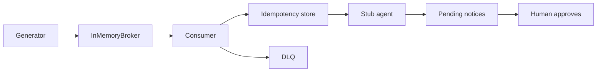

# cdc-to-agent-events-lab

## Start here

This lab proves a synthetic change stream can apply each event once, park poison on a dead-letter queue, and leave a notice pending, with zero invariant violations across 10 scenarios.
Run `python3 -m cdc_lab eval` (install once with `python3 -m pip install -e ".[dev]"`).
Walkthrough: [docs/HOW_IT_WORKS.md](docs/HOW_IT_WORKS.md).

Synthetic change stream for the fictional shipper Ruta Sur Logística (mailboxes on `@rutasur.example`): at-least-once delivery, an idempotent state write, and a stub agent that only prepares notices. A person approves a notice before `send` will accept it. This is not a live deployment, and it has not been pointed at a real database.

> **Honest limits.** CI exercises an in-memory broker and a simulated clock. The Docker and Kafka files are optional and are not started by CI. No Debezium connector, Postgres instance, or Kafka cluster was used for the numbers below. Cassette token counts are 0 because the text is local. **Measured with real providers: none yet.**

## Problem

A delayed premium shipment should become one notice, even when the change event is delivered twice, arrives out of order, or the process stops after the state write and before the offset commit. A poison record must sit on a dead-letter queue instead of blocking other keys. The notice stays pending until a named person approves it. Nothing in this repository sends mail, charges a card, or calls a model.

The failure the gate is built to see is the opposite: turn idempotency off and the same event is applied 5 times. That forced regression exits 1 on purpose.

## Architecture



The default path has no network. Keys land on `sha256(key) % N` partitions (`src/cdc_lab/events.py`), not on Python's per-process hash. A commit may advance a watermark by at most one and may not move backwards. An unacknowledged head is invisible until the visibility lease ends, then the same offset is delivered again.

Effect and dedupe commit in one store transaction, keyed by consumer and `event_id`. The broker offset commits only after that transaction commits. A lower log sequence number (LSN) for a key is counted as stale and does not overwrite newer state. Permanent decode errors and permanent downstream errors go to the dead-letter queue with the original bytes, and that offset still commits so other keys move.

The agent runs after the change has been applied. It is not inside the transaction that writes shipment state. Rules are local: a premium customer whose shipment becomes `delayed`, or a promised date that slips by more than `CDC_DATE_SLIP_DAYS` (default 2). The cassette has two templates in `src/cdc_lab/cassette.py`. They say the notice is pending approval and has not been sent. Token counts on those responses are 0. `send` raises `NotApproved` until `approve` has recorded a non-empty approver name. `CDC_AGENT_ENABLED=0` keeps consuming and records the outbox row as suppressed. It does not call the cassette.

`KafkaBroker` implements the same produce, poll, commit, and end-offset surface and imports `confluent-kafka` only when it is constructed without injected clients. Exactly-once Kafka transactions are not implemented. Detail: [docs/architecture.md](docs/architecture.md), [docs/DELIVERY_SEMANTICS.md](docs/DELIVERY_SEMANTICS.md).

## Quickstart

Cost of this path: 0 USD. No API key. The package does not load `.env`. Names and empty-or-default values are in `.env.example`.

```bash
python3 -m pip install -e ".[dev]"
python3 -m cdc_lab demo
python3 -m cdc_lab eval
python3 -m cdc_lab eval --regression
```

`eval` exits 0 when every invariant holds. `--regression` disables idempotency on the duplicate burst and must exit 1. A zero exit from the regression means the gate can no longer see a double apply.

`make setup`, `make demo`, `make eval`, and `make eval-regression` call the same tools. `make` may be absent; the `python3 -m` forms are enough.

## Demo

`python3 -m cdc_lab demo` builds an 80-event mix with seed 7 through the helper in `src/cdc_lab/cli.py` (`_mixed`), prints the accounting identity, prints `clock: simulated`, and prints how many notices are still pending. Logs are JSON on stderr.

That helper is not `scenarios/mixed_faults.yaml`. Both are named `mixed_faults` and both use seed 7 and 80 events. The knobs differ (the helper asks for 3 duplicates and 1 malformed record plus 1 schema violation; the YAML file asks for 8 duplicates and 7 poison records). On 2026-10-22, package 0.1.0, Python 3.12.3, `CDC_LOG_LEVEL=WARNING python3 -m cdc_lab demo` printed:

```
scenario: mixed_faults
produced: 80
applied: 59
skipped_stale: 16
duplicates_skipped: 3
dlq: 2
violations: 0
latency_clock: simulated
clock: simulated
drafts_pending: 10
```

Those counters are **SIMULATED** (a seeded generator and a simulated clock). The command was run on that date; it is not a wall-clock service level. 59 + 16 + 3 + 2 = 80, which is the no-loss identity. The 10 pending notices are not the 4 notices priced in the business case. The priced 4 come from `scenarios/agent_breaker.yaml`.

## Business case

Four premium-delay notices in the breaker scenario, valued at 12 USD each as a support contact, are **48 USD [EST]**. The lab run itself is 0 USD (no paid API). The 12 USD figure is not a vendor price and not a contract. A reviewer reject rate is not measured, so the 48 USD figure assumes every notice is accurate. Detail: [docs/BUSINESS_CASE.md](docs/BUSINESS_CASE.md). The value plan that reuses those figures, and does not add new ones, is [docs/BUSINESS_VALUE.md](docs/BUSINESS_VALUE.md).

## Results

Eval, regression, and the in-memory bench below were first recorded on 2026-10-17, package 0.1.0, against commit `f458fa4`. `git diff --stat f458fa4` to the package tree measured on 2026-10-22 (`e82c512`) touches only `README.md`, so the package sources match. The gate and the regression were run again on 2026-10-22 (Python 3.12.3) and printed the same violation line. The bench was **not** re-run on 2026-10-22; its elapsed time stays the 2026-10-17 sample.

| What | Value | Kind |
| --- | --- | --- |
| Eval violations | 0 / 10 scenarios, exit 0 | MEASURED 2026-10-17, `python3 -m cdc_lab eval`. Same gate text on 2026-10-22 |
| Regression | exit 1; `evt-000001` applied 5 times | MEASURED 2026-10-17, `python3 -m cdc_lab eval --regression`. Same line on 2026-10-22 |
| Tests | 68 passed, 95.55% line coverage | MEASURED 2026-10-22, Python 3.12.3, pytest 9.1.1. Earlier row: same 68 and 95.55% on 2026-10-17. See [Proof](#proof) |
| Bench | 115.76 events/s, 2000 events, 17.276627 s, 0 violations, 1 sample | MEASURED 2026-10-17, in-memory, not a Kafka benchmark, `python3 -m cdc_lab bench --events 2000 --seed 7` on Linux. Not re-run on 2026-10-22 |
| Real providers | none yet | not measured |

The bench label in the JSON is `measured, in-memory, not a Kafka benchmark`. Default INFO logging writes a JSON line per effect to stderr inside the timed section. It is one sample. It is not a confidence interval.

### Gate text

Both the 2026-10-17 record and the 2026-10-22 re-run print this. `non_vacuous` counts scenarios that actually exercised the invariant. A pass with nothing to look at would still be a pass, and the table says so.

```
mode: gate
scenarios: 10
no_loss: pass=10 fail=0 non_vacuous=10
exactly_once_effect: pass=10 fail=0 non_vacuous=10
per_key_order: pass=10 fail=0 non_vacuous=10
retries_bounded: pass=10 fail=0 non_vacuous=1
poison_isolation: pass=10 fail=0 non_vacuous=4
lag_drains: pass=10 fail=0 non_vacuous=10
agent_budget: pass=10 fail=0 non_vacuous=10
dlq_replay: pass=10 fail=0 non_vacuous=2
violations: 0
```

Retries are non-vacuous in 1 scenario, poison in 4, replay in 2. That is one suite, not repeated experiments.

The regression prints one violation: `exactly_once_effect`, event `evt-000001` applied 5 times, and the line `component: consumer idempotency disabled on duplicate_burst`.

### What each invariant checks

| Invariant | Plain meaning |
| --- | --- |
| `no_loss` | applied + stale + duplicates skipped + dead-letter count equals produced |
| `exactly_once_effect` | no `event_id` has an effect count above 1 |
| `per_key_order` | final state matches the highest LSN per key |
| `retries_bounded` | attempt counts stay inside 0..`max_attempts`, and backoff stays inside 0..cap |
| `poison_isolation` | each poison record is on the dead-letter queue with its original bytes, and other keys are not blocked |
| `lag_drains` | final lag is 0, or a lag alert was raised |
| `agent_budget` | invocations in the window stay inside the budget, one event is not invoked twice, and unapproved sends stay at 0 |
| `dlq_replay` | each replayable record is applied once |

### Seeded scenario counters

Counters below come from the scenario files on a simulated clock. They are **SIMULATED**, not wall-clock service levels. On 2026-10-22 the same scenario objects were run again in-process. The integers match the table already in [docs/METRICS.md](docs/METRICS.md).

| Scenario | Produced | Applied | Stale | Duplicates | DLQ | What the file injects |
| --- | ---: | ---: | ---: | ---: | ---: | --- |
| `duplicate_burst` | 5 | 1 | 0 | 4 | 0 | the same event five times |
| `out_of_order` | 2 | 1 | 1 | 0 | 0 | a higher LSN arrives before a lower one |
| `poison_middle` | 4 | 3 | 0 | 0 | 1 | one malformed record between valid keys |
| `transient_recovery` | 1 | 1 | 0 | 0 | 0 | two transient handler faults, then success |
| `permanent_replay` | 2 | 2 | 0 | 0 | 0 | a permanent fault, then the `identity` replay profile |
| `crash_after_effect` | 5 | 5 | 0 | 0 | 0 | one crash after the store commit and before the offset commit; each effect count is 1 |
| `lag_drain` | 20 | 20 | 0 | 0 | 0 | lag peaks at 20 records, the alert fires, final lag is 0 |
| `agent_breaker` | 5 | 5 | 0 | 0 | 0 | breaker opens and closes; 4 notices, all pending |
| `schema_bump` | 3 | 3 | 0 | 0 | 0 | version 2 is dead-lettered, then `accept_schema_v2` replays it |
| `mixed_faults` YAML | 80 | 32 | 33 | 8 | 7 | seed 7; 32 + 33 + 8 + 7 = 80. The file's duplicate knob is 8 and its poison knobs sum to 7. Stale skips (33) are not the same counter as the 4 out-of-order swaps in the file |

`lag_drain` uses a simulated clock, a lag threshold of 5 records, and a hold of 300 simulated milliseconds (`scenarios/lag_drain.yaml`). The default process settings are a threshold of 1000 records and a hold of 30000 milliseconds. The scenario file overrides them. Do not read the peak of 20 as a broker service level.

The YAML mix also left 6 pending notices on the 2026-10-22 re-run. That count is not an input to the 48 USD [EST] story. The story uses the 4 notices from `agent_breaker` only.

Lag seconds, retry sleeps, and the processing-latency histogram use the simulated clock. The snapshot field `clock` is `simulated`. Prometheus text is rendered in-process. There is no metrics server.

## Use cases, governance and business strategy

Ruta Sur Logística is fictional. The rows are patterns, not an engagement.

### Client-style

| Use case | Status | Problem | Who approves | Gated effects | How this repo handles it |
| --- | --- | --- | --- | --- | --- |
| Delay notices for a fictional shipper | Implemented, synthetic | A premium delay, or a promised date that slips by more than the configured number of days, should become one notice | A named person, before send | No send until `approve` records a name. `send` raises `NotApproved` otherwise | Rules in `agent_trigger.py`, cassette, pending notices |
| Fraud or anomaly review | Design only | A reviewer queue over the change stream | A risk owner, not built | Would page or hold freight | Not implemented |
| Search index or cache sync | Design only | A projector must follow the log | The index owner | Dual writes | Not implemented. The state store is the only projector |

### Personal

| Use case | Status | Problem | Who approves | Gated effects | How this repo handles it |
| --- | --- | --- | --- | --- | --- |
| Notes database summary | Design only | Summarise local notes when a row changes | The notes owner | A model call | No live model. The cassette errors when the entry is missing |
| Home automation with a kill switch | Design only | A sensor change must not act while the switch is off | The resident | Relays, locks | `CDC_AGENT_ENABLED=0` pauses the trigger and keeps consuming. No device I/O exists |

### Design-only vs implemented

| Piece | Status |
| --- | --- |
| Generator, in-memory broker, consumer, dead-letter queue, replay, stub agent, eval gate | Implemented |
| SQLite idempotency, and an in-memory store with the same methods | Implemented |
| Crash points `before_store_commit` and `after_store_before_offset` | Implemented |
| JSON metrics and Prometheus text, no server | Implemented |
| Kafka adapter, `docker-compose.yml`, Dockerfile | Code and compose exist. Not exercised in CI. The image is not built in CI |
| Logical decoding, a running Debezium connector, schema registry, live model, a sender, Kubernetes, autoscaling, multi-region | Design only |

### Governance

| Control | Where it lives | Gap |
| --- | --- | --- |
| Topic and schema ownership | `src/cdc_lab/topics.py` (`rutasur.cdc.events`, `rutasur.cdc.dlq`, group `rutasur-materializer`), `schemas/change_event.schema.json` (version 1 only) | No schema registry |
| Schema-change process | ADR 0004. `accept_schema_v2` only through replay. Unknown versions go to the dead-letter queue | No compatibility suite beyond version 1 vs everything else |
| Dead-letter owner and triage | [docs/RUNBOOK.md](docs/RUNBOOK.md) | No on-call rota. A triage time is not measured |
| Replay approval | `python3 -m cdc_lab replay` requires `--fix-profile` (`identity` or `accept_schema_v2`) | The CLI does not record the approver's name |
| Notice approval | `AgentTrigger.approve` then `send` | No second person is required. Any non-empty name is accepted |
| Kill switch | `CDC_AGENT_ENABLED` | Process-local only |
| Invocation budget and breaker | Defaults: 50 calls per 60000 ms window, open after 3 consecutive failures, cooldown 30000 ms | In-process. Not a shared counter |
| Data minimisation | `logging_json.py` and traces drop email, phone, name, display name, and address, and redact secret-shaped substrings | Payload bytes still sit in the dead-letter table |
| Secrets out of the tree | `python3 -m cdc_lab.secretscan`, [SECURITY.md](SECURITY.md) | The scanner is pattern-based |
| No paid call in CI | No model client exists. Eval does not open a broker socket | A future live model is design only |

Not covered yet: a schema registry, multi-region ordering, a real sender, a shared budget across processes, and a recorded replay approver.

### Business strategy

The business problem is narrow: a shipper wants one accurate notice when a premium shipment slips, and does not want a retry to send it twice or a bad record to stall the rest of the stream. Scope is the synthetic path in [docs/SCOPE.md](docs/SCOPE.md). The only money model in the repo is the **[EST]** paragraph above and [docs/BUSINESS_CASE.md](docs/BUSINESS_CASE.md). Success metrics that were actually run are in [docs/METRICS.md](docs/METRICS.md). Simulated counters are labelled there.

Ten discovery questions (which tables, who owns the topic, whether the LSN is monotonic per key, what poison means, whether the effect sends or only writes state, who may replay, who approves a notice, what the budget is, which fields stay out of logs, what lag should alert) are in [docs/DISCOVERY.md](docs/DISCOVERY.md). They are unanswered for a real connector.

Deployment conversation, in the order the docs already use: start from those questions, not from a model name. Keep this suite as the regression net. Refuse to publish the bench as broker throughput. Require a named replay approver and a tested kill switch before any send exists. Leave the line "Measured with real providers: none yet" until a separate log exists. The shipper would own the notice rules and the approvals. The platform owner would own the log, the dead-letter queue, and the rollback. This lab is the checklist for that conversation. It is not evidence that the conversation already happened with a live desk.

## Business value

The buyer in the story is the fictional shipper. The reader of the plan is an engineer or a buyer reviewing this lab. The only priced outcome is the 48 USD **[EST]** above, against a software bill of 0 USD for the default path. A percentage return is not computed, because that bill is zero and [docs/COST.md](docs/COST.md) refuses to invent a cluster quote. Full plan, with the baseline and target table, the formula, the cost table, the measurement plan, and the risks: [docs/BUSINESS_VALUE.md](docs/BUSINESS_VALUE.md).

## Proof

**MEASURED 2026-10-22.** Package 0.1.0. Python 3.12.3. pytest 9.1.1. Command:

```bash
python3 -m pytest --cov=cdc_lab --cov-report=term-missing --cov-fail-under=80
```

Result: **68 passed**, **95.55%** line coverage. That percentage is the `Total coverage` line pytest-cov printed. The coverage table's total row shows 96% for the same 2516 statements and 112 misses; 2404 / 2516 rounds to 95.55%, and the table column rounds to 96%. The run also printed `CoverageWarning: Module cdc_lab was previously imported, but not measured`. The 95.55% figure is the total that was printed anyway. Fail-under is 80, from `pyproject.toml`, and the run cleared it. Branch coverage is off (`branch = false` in that file). The same 68 passed and 95.55% were already recorded on 2026-10-17; this row is a new run of the same package, not a new test suite.

The code under test is commit `e82c512`. A documentation commit on top of that commit does not change `src/` or `tests/`.

## Decisions

- [ADR 0001](docs/adr/0001-in-memory-broker.md) — in-memory broker by default. CI stays socket-free.
- [ADR 0002](docs/adr/0002-idempotency-store.md) — effect and dedupe in one transaction; offset after.
- [ADR 0003](docs/adr/0003-stub-agent.md) — cassette, no live model. Notices start as `pending`.
- [ADR 0004](docs/adr/0004-jitter-and-dlq.md) — full jitter from a seeded RNG, poison to the dead-letter queue.

## Security and known limits

Threat notes: [SECURITY.md](SECURITY.md). The optional compose file's database password is a localhost placeholder for a fictional database; it is named in that security note and is not a live credential. Patterns: `python3 -m cdc_lab.secretscan`. On 2026-10-22 that command printed `secret scan: no findings`.

Logs and traces omit direct identifiers and redact substrings that match the scanner. Redacting fiction is not compliance with a privacy law.

## What this does NOT prove

- It does not run Debezium, Postgres, or Kafka in CI, and it does not measure their lag or throughput. The bench is one in-memory sample.
- It does not prove exactly-once Kafka transactions. The guarantee is at-least-once delivery plus an idempotent state write. That is effectively-once for this effect only.
- It does not prove the effect is safe to replay if a later worker sends, charges, or pages. Replay here rewrites state. [docs/DELIVERY_SEMANTICS.md](docs/DELIVERY_SEMANTICS.md) says a sender must not reuse it blindly.
- It does not send notices, and it does not call a model. "Measured with real providers: none yet" is still the status.
- It does not prove a live deployment, a multi-region order, a schema registry, or an on-call rota.
- It does not prove the 48 USD **[EST]** story. Four notices, 12 USD each, and "one contact avoided if the notice is accurate" are assumptions. A reject rate is not measured.
- It does not prove the regression is a property of a running server. The regression fails because the harness turns idempotency off. The demo does not have a switch that turns it off.
- The aggressive claim it refuses: quoting 115.76 events/s as Kafka capacity, or quoting simulated lag as a service level.

## How to reproduce

Cost: **zero**. No key, no vendor, no network during tests or eval.

```bash
python3 -m pip install -e ".[dev]"
python3 -m ruff check src tests && python3 -m ruff format --check src tests
python3 -m mypy
python3 -m pytest --cov=cdc_lab --cov-report=term-missing --cov-fail-under=80
python3 -m cdc_lab eval
python3 -m cdc_lab eval --regression
python3 -m cdc_lab.secretscan
python3 -m cdc_lab demo
```

The regression process **must exit non-zero**. CI fails the job if that exit code is 0.

| Make target | Equivalent |
| --- | --- |
| `make setup` | `python3 -m pip install -e ".[dev]"` |
| `make lint` | `python3 -m ruff check src tests && python3 -m ruff format --check src tests && python3 -m mypy` |
| `make format` | `python3 -m ruff format src tests && python3 -m ruff check --fix src tests` |
| `make test` | `python3 -m pytest` (addopts in `pyproject.toml` already request coverage and fail-under 80) |
| `make eval` | `python3 -m cdc_lab eval` |
| `make eval-regression` | `python3 -m cdc_lab eval --regression` (exit 1 is success of the check) |
| `make secretscan` | `python3 -m cdc_lab.secretscan` |
| `make demo` | `python3 -m cdc_lab demo` |
| `make bench` | `python3 -m cdc_lab bench --events 2000 --seed 7` |

Also: `python3 -m cdc_lab generate --seed 7 --events 500`. A saved run can be replayed with `python3 -m cdc_lab replay --workdir DIR --from-dlq --fix-profile identity` or `--fix-profile accept_schema_v2`. Offset replay reads `log.jsonl` and the store skips work already applied. Choose exactly one of `--from-dlq` or `--from-offset`.

### Defaults the process uses when the environment is empty

| Setting | Default | Environment name |
| --- | ---: | --- |
| Partitions | 4 | `CDC_PARTITIONS` |
| Max attempts | 5 | `CDC_MAX_ATTEMPTS` |
| Backoff base / cap | 100 ms / 5000 ms | `CDC_BACKOFF_BASE_MS`, `CDC_BACKOFF_CAP_MS` |
| Visibility lease | 30000 ms | `CDC_VISIBILITY_MS` |
| Max payload | 8192 bytes | `CDC_MAX_PAYLOAD_BYTES` |
| Lag alert | 1000 records for 30000 ms | `CDC_LAG_THRESHOLD`, `CDC_LAG_HOLD_MS` |
| Agent enabled | on | `CDC_AGENT_ENABLED` |
| Agent budget | 50 per 60000 ms | `CDC_AGENT_BUDGET`, `CDC_AGENT_WINDOW_MS` |
| Breaker | 3 failures, cooldown 30000 ms | `CDC_AGENT_BREAKER_THRESHOLD`, `CDC_AGENT_COOLDOWN_MS` |
| Coalesce window | 5000 ms, per shipment key | `CDC_COALESCE_WINDOW_MS` |
| Date slip | more than 2 days | `CDC_DATE_SLIP_DAYS` |
| SQLite path | `var/cdc.sqlite` | `CDC_SQLITE_PATH` |
| Log level | `INFO` | `CDC_LOG_LEVEL` |

Scenario files override these for that run. The lab does not read a dotenv file.

## Next steps

1. Measure a real broker only when one is running, in a separate note. Delete any throughput number that came from `bench` before quoting that broker.
2. A live model stays behind the cassette until a budget you can reconcile, a tested kill switch, and an approval record exist. Until then, leave "Measured with real providers: none yet" in place.
3. Replay should record an approver name before anyone points it at a sender.
4. Replace the 12 USD **[EST]** contact cost with the operator's own figure, and measure how often a reviewer rejects a notice. That measurement does not exist here.

## Docs

| Doc | What it is for |
| --- | --- |
| [docs/HOW_IT_WORKS.md](docs/HOW_IT_WORKS.md) | Walkthrough for engineers and buyers |
| [docs/BUSINESS_VALUE.md](docs/BUSINESS_VALUE.md) | Value plan. Money figures are the repo's own [EST] or a measured zero |
| [docs/BUSINESS_CASE.md](docs/BUSINESS_CASE.md) | The 48 USD [EST] story and what would have to be true |
| [docs/DISCOVERY.md](docs/DISCOVERY.md) | Ten questions and what stays design-only until they are answered |
| [docs/SCOPE.md](docs/SCOPE.md) | In the repo, design only, and what is explicitly not claimed |
| [docs/RISKS.md](docs/RISKS.md) | Qualitative likelihood, impact, mitigation, residual |
| [docs/METRICS.md](docs/METRICS.md) | Measured commands and simulated counters |
| [docs/COST.md](docs/COST.md) | 0 USD for the default path. Cluster cost not estimated |
| [docs/RUNBOOK.md](docs/RUNBOOK.md) | Lag, dead letters, poison, schema, breaker, replay, crash |
| [docs/architecture.md](docs/architecture.md) | Module map |
| [docs/DELIVERY_SEMANTICS.md](docs/DELIVERY_SEMANTICS.md) | Crash between effect and offset, and when replay is safe |
| [docs/ADAPT_TO_A_REAL_CLIENT.md](docs/ADAPT_TO_A_REAL_CLIENT.md) | What to throw away first |
| [docs/PROVENANCE.md](docs/PROVENANCE.md) | Shared secret-scanner lineage. The digest lives there, not here |
| [docs/adr/](docs/adr/) | Decisions |
| [SECURITY.md](SECURITY.md) | Reporting and scope |
| [CHANGELOG.md](CHANGELOG.md) | Package 0.1.1 and the earlier documentation note |

## Authorship and how this was built

This repository was built with AI-assisted development.

**What Diego Lescano set:**
- The problem and the scope: which failure to show, what is out of scope, and what the repo must not claim.
- The governance and business-strategy requirements: approval, traceability, risks, costs, an estimated return only where the repo already has the inputs, rollout, and metrics.
- The engineering standards: Python, tests, CI, synthetic data only, no real client or employer data.
- What became public, and the rule that live-provider numbers stay at "none yet" until a separate log exists.

**What AI coding agents did:**
- Wrote most of the code, tests, and documentation from those briefs.

**What this repo does not claim:**
- It is not a live system, and every data set is synthetic.
- There is no live-provider sample in this repository. The bench is one in-memory sample. The 48 USD figure is [EST].
