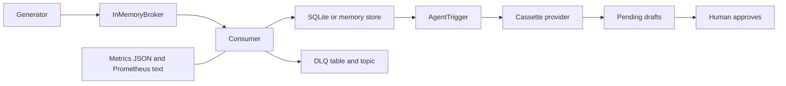

# Architecture

The default path has no network. `KafkaBroker` is a second implementation of the same produce / poll / commit / end-offset surface. It is constructed only when the optional extra is installed or when tests inject fakes.

Offsets move forward by at most one. Lag is end offset minus the committed watermark, per partition and summed.

The agent runs after the change stream has been applied, in dispatch rounds. It does not sit inside the database transaction that writes shipment state. A failure to draft leaves the CDC effect in place and the outbox row pending or untouched.

Design-only boxes that are not in the diagram as running code: logical decoding, a schema registry, a live model, and a sender.
