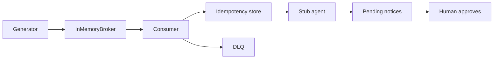

# cdc-to-agent-events-lab

## Start here

This lab proves a synthetic change stream can apply each event once, park poison on a dead-letter queue, and leave a notice pending, with zero invariant violations across 10 scenarios.
Run `python3 -m cdc_lab eval` (install once with `python3 -m pip install -e ".[dev]"`).
Walkthrough: [docs/HOW_IT_WORKS.md](docs/HOW_IT_WORKS.md).

Synthetic change stream for the fictional shipper Ruta Sur Logistics (mailboxes on `@rutasur.example`): at-least-once delivery, an idempotent state write, and a stub agent that only prepares notices. A person approves a notice before `send` will accept it. This is not a live deployment, and it has not been pointed at a real database.

> **Honest limits.** CI exercises an in-memory broker and a simulated clock. The Docker and Kafka files are optional and are not started by CI. No Debezium connector, Postgres instance, or Kafka cluster was used for the numbers below. Cassette token counts are 0 because the text is local. **Measured with real providers: none yet.**

## Problem

A delayed premium shipment should become one notice, even when the change event is delivered twice, arrives out of order, or the process stops after the state write and before the offset commit. A poison record must sit on a dead-letter queue instead of blocking other keys. The notice stays pending until a named person approves it. Nothing in this repository sends mail, charges a card, or calls a model.

The failure the gate is built to see is the opposite: turn idempotency off and the same event is applied 5 times. That forced regression exits 1 on purpose.

## Architecture

The default path has no network. Keys land on `sha256(key) % N` partitions (`src/cdc_lab/events.py`), not on Python's per-process hash. A commit may advance a watermark by at most one and may not move backwards. An unacknowledged head is invisible until the visibility lease ends, then the same offset is delivered again.

Effect and dedupe commit in one store transaction, keyed by consumer and `event_id`. The broker offset commits only after that transaction commits. A lower log sequence number (LSN) for a key is counted as stale and does not overwrite newer state. Permanent decode errors and permanent downstream errors go to the dead-letter queue with the original bytes, and that offset still commits so other keys move.

The agent runs after the change has been applied. It is not inside the transaction that writes shipment state. Rules are local: a premium customer whose shipment becomes `delayed`, or a promised date that slips by more than `CDC_DATE_SLIP_DAYS` (default 2). The cassette has two templates in `src/cdc_lab/cassette.py`. They say the notice is pending approval and has not been sent. Token counts on those responses are 0. `send` raises `NotApproved` until `approve` has recorded a non-empty approver name. `CDC_AGENT_ENABLED=0` keeps consuming and records the outbox row as suppressed. It does not call the cassette.

`KafkaBroker` implements the same produce, poll, commit, and end-offset surface and imports `confluent-kafka` only when it is constructed without injected clients. Exactly-once Kafka transactions are not implemented. Detail: [docs/architecture.md](docs/architecture.md), [docs/DELIVERY_SEMANTICS.md](docs/DELIVERY_SEMANTICS.md).

## Quickstart
